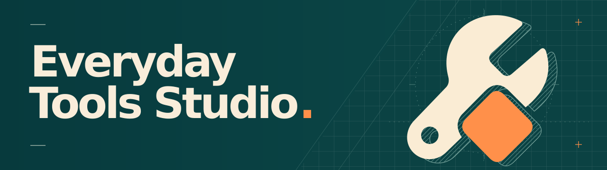

# 

[English](README.md) · **Français**

Nous créons des logiciels libres et locaux en priorité pour les gestes du quotidien. Notre premier projet est parti d’une expérience familière. On dicte une idée en marchant, puis on l’oublie une fois devant l’ordinateur.

## Mon cerveau

Un carnet personnel local en priorité pour **Android et Linux**. Notes, mémos vocaux, tâches et rendez-vous se retrouvent dans une boîte de réception commune. Tu peux y déposer une idée et décider plus tard de ce que tu veux en faire.

| Sur ton téléphone | Devant ton ordinateur |
| --- | --- |
| Dicte un mémo hors ligne ou partage un lien vers l’application. | Synchronise tes captures sur le Wi-Fi de la maison. Cherche un mot dans la transcription française ou réécoute le mémo. |
| Note quelque chose que tu voudrais terminer. | Transforme la note en tâche et épingle le prochain geste pour savoir par quoi reprendre. |

La capture, la synchronisation, la transcription vocale et l’analyse IA facultative fonctionnent **d’abord en local** sur tes appareils — avec la possibilité de connecter ton propre fournisseur (**Claude**, **Codex / OpenAI** ou compatible) si tu le souhaites. L’interface est en français et la documentation se lit en français ou en anglais.

**[Découvrir Mon cerveau →](https://github.com/everyday-tools-studio/my-brain/blob/main/README.fr.md)** · [Configurer le téléphone et le PC](https://github.com/everyday-tools-studio/my-brain/blob/main/docs/fr/demarrage.md)

### Améliorer la détection dans les messages

L’application a mal interprété une date ou une tâche ? Un message inventé, un fuseau horaire et le résultat que tu attendais nous aident à en faire un cas de test. [Guide de contribution](https://github.com/everyday-tools-studio/my-brain/blob/main/CONTRIBUTING.md#fran%C3%A7ais)
