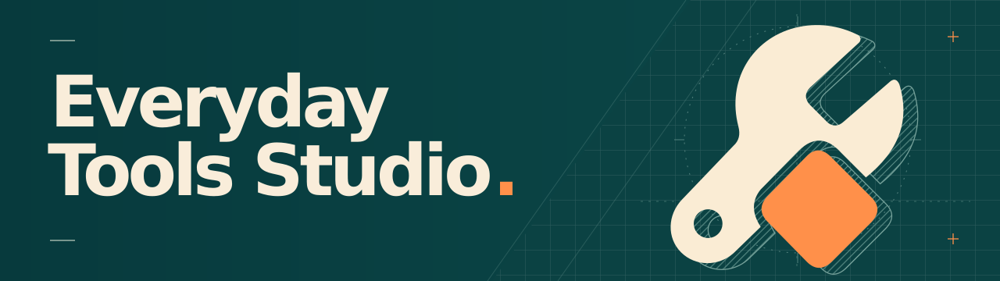

# 

**English** · [Français](README.fr.md)

We build local-first, open-source software for everyday routines. Our first project grew out of a familiar problem. You record an idea on a walk, then forget about it by the time you sit down at your desk.

## My Brain

A personal, local-first notebook for **Android and Linux**. Notes, voice memos, tasks and appointments share one inbox. Save something now and decide what to do with it later.

| On your phone | At your desk |
| --- | --- |
| Record a voice memo offline or share a link into the app. | Sync over your home Wi-Fi. Search the French transcript or play the recording. |
| Jot down something you want to finish. | Turn the note into a task and pin the next step for when you return. |

Capture, sync, voice transcription and optional AI analysis run **locally first** on your own devices — and you can connect your own **Claude**, **Codex / OpenAI**, or compatible provider whenever you choose. The app interface is in French, and documentation is available in English and French.

**[Explore My Brain →](https://github.com/everyday-tools-studio/my-brain)** · [Set up your phone and PC](https://github.com/everyday-tools-studio/my-brain/blob/main/docs/en/getting-started.md)

### Help improve message recognition

Did a French expression for a date or task trip up the app? An invented message, a time zone and the result you expected make a useful test case. [Contributing guide](https://github.com/everyday-tools-studio/my-brain/blob/main/CONTRIBUTING.md#english)
